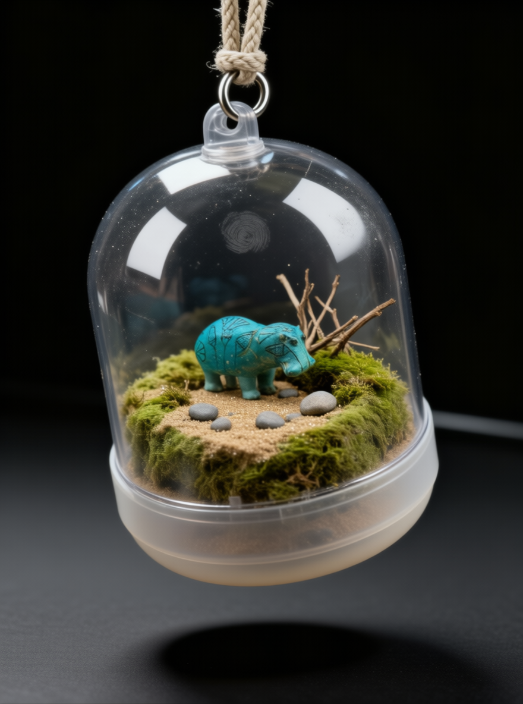
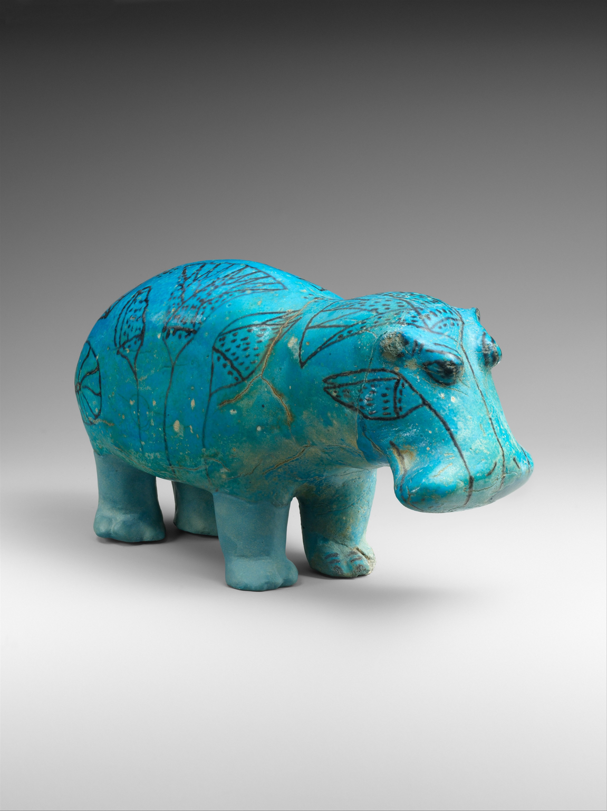
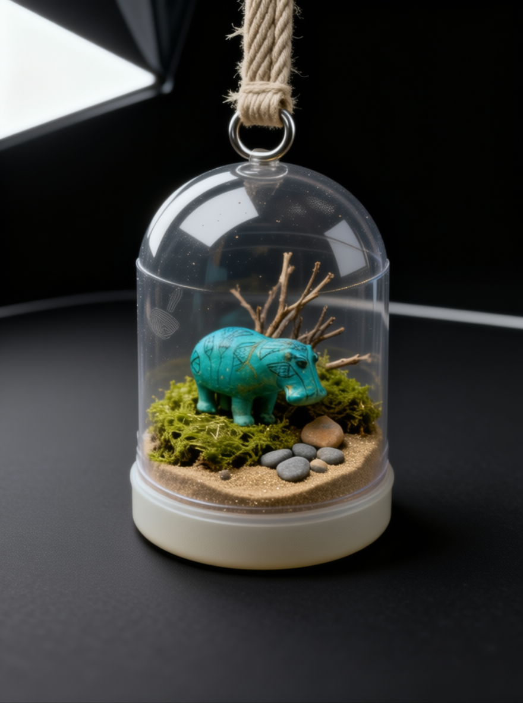
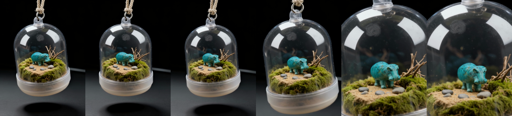
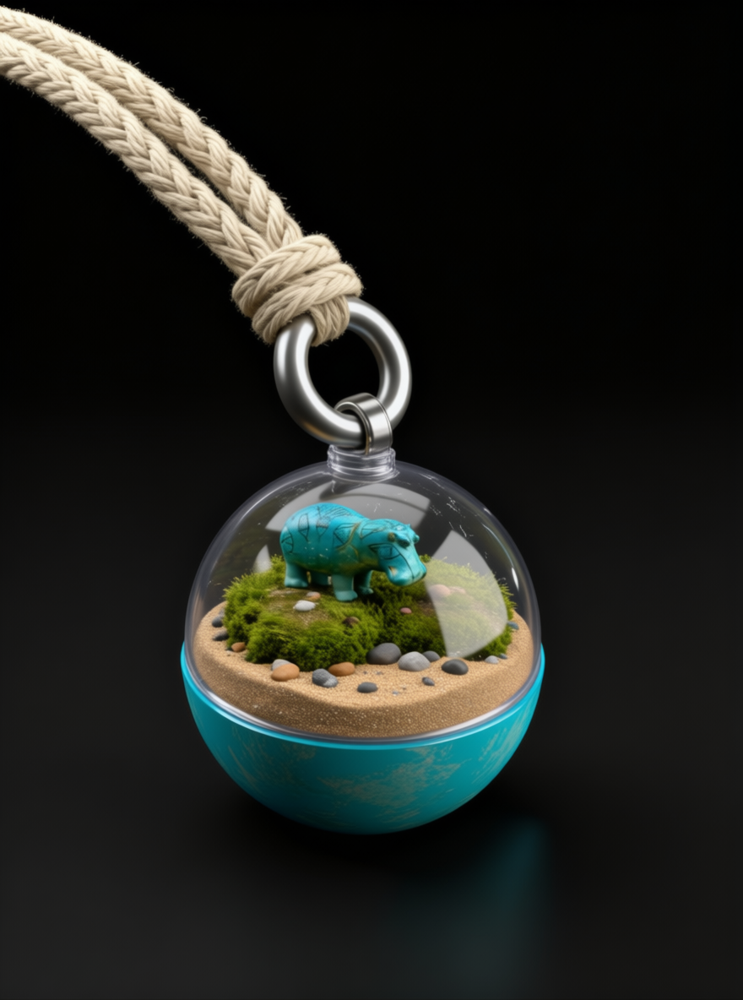
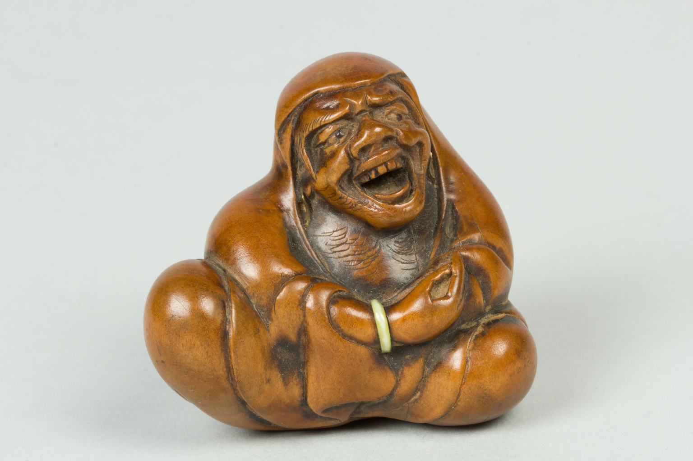
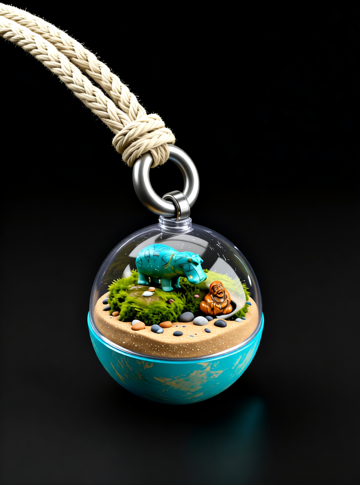

# Capamari

> Gachapon, but the ball remembers. Every roll presses one more museum object into a little moss ball inside a capsule, katamari style.

An entry for Comfy's [Open Source Higgsfield](https://comfy.org/open-source-higgsfield) competition. Open weights only, core ComfyUI nodes only, no closed APIs. Repo licensed Apache-2.0 (the LTX-2.3 / Gemma weights used for the video are not; see Model licenses).

AI-generated (Qwen-Image-Edit-2511, `workflows/capamari-first-pull-real.json`, seed `424242424242`).
Then a Higgsfield-style camera move on open weights (LTX-2.3, `workflows/capamari-video.json`):
[`examples/outputs/capamari_sway.mp4`](examples/outputs/capamari_sway.mp4) (8 s, with audio, AI-generated).

## What it does

A Higgsfield-style one-tap preset ("pull the lever") with one twist: the output has state. Each result is fed back in
as the next input, so one capsule keeps collecting objects and you share the series.

1. **First pull** (`workflows/capamari-first-pull-real.json`): Qwen-Image-Edit-2511 takes one object photo (image 1)
   and renders capsule #1 as a real macro product photo: a clear gachapon capsule hanging from a braided cotton strap,
   a small handmade diorama of moss, twigs, sand and pebbles inside, the object set into the moss at toy scale.
   Alternative look: `workflows/capamari-first-pull.json` renders the same capsule as a Cinema 4D / Octane-style
   studio render.
2. **Camera move** (`workflows/capamari-video.json`): the Higgsfield-style "camera move" preset, done with open
   weights. LTX-2.3 image-to-video with audio (official Comfy-Org template) takes the first pull as its first frame
   and makes 8 s of footage: the capsule sways gently on its cord while the camera pushes in on a slider. No closed
   APIs, no partner nodes.
3. **Roll** (`workflows/capamari.json`): image 1 = the previous capsule, image 2 = a new object photo. The prompt keeps
   everything already in the capsule and has the ball pick up the new object, as if it rolled over it.
4. Repeat. Suggested order from `inputs/`: hippo "William" → netsuke → 17th-century watch → Chinese toy.

The real-look first pull asks for an unedited macro product photo (100 mm macro, one softbox from above left, thin rim,
no fill, pure black, film-like grain). The C4D first pull and the roll ask for a Cinema 4D / Octane-style studio render
on pure black with the same lighting. **The roll has only been verified on the C4D look**; it has not been run on the
real-look capsule yet. Prompts live in the workflows; the C4D and roll text is also in `prompts/prompts.json`.

**Run status (2026-11-03 ET):** all four workflows have been run on Comfy Cloud.

- Real-look first pull: `examples/outputs/real/hero_b.png` (seed `424242424242`, the hero above) and
  `examples/outputs/real/hero_a.png` (seed `677909188488042`), from `inputs/pull_01_hippo.png`,
  `qwen_image_edit_2511_fp8mixed`, Lightning **off** (40 steps, CFG 4), euler / simple. The workflow ships with the
  seed fixed at `424242424242`, so it reproduces hero_b.
- Video: `examples/outputs/capamari_sway.mp4` (8.04 s, 704x960, 25 fps, H.264 + AAC audio), from hero_b saved as
  `capamari_hero_real.png`, seed `20261103`. Unedited. The push-in goes further than the prompt asked (it ends on a
  close-up of the hippo rather than a 10% push), but the capsule and its contents hold together for the whole clip.
  A first attempt (an orbit prompt on the older C4D capsule) morphed after about 4 s and was discarded.

The C4D series, `qwen_image_edit_2511_fp8mixed`, seed `677909188488042`, euler / simple, is two images:

- First pull: `examples/outputs/capamari_first_pull_c4d.png`, from `inputs/pull_01_hippo.png`, Lightning **off**
  (40 steps, CFG 4). The first-pull workflow ships with Lightning off to match.
- Roll 1: `examples/outputs/series/pull_02.png`, image 1 = that first pull, image 2 = `inputs/pull_02_netsuke.png`,
  Lightning **on** (4 steps, CFG 1). The roll workflow ships with Lightning on. For this run the roll prompt from
  `prompts/prompts.json` was prefixed with one sentence naming what is already on the ball and what image 2 is
  (exact text under Example outputs).

**Known limitation:** the series does not hold beyond those two images yet. In our further rolls (watch, then toy)
the model dropped or swapped earlier objects (the watch was not added in two tries; the next roll lost the netsuke)
and dark coloured noise built up in the black background with each pass through the VAE. Those rolls are not
included as results. With Lightning off (40 steps, CFG 4), rolls came out posterized in testing, so rolls use Lightning.

`scripts/clean_black.py` is an optional, experimental clean-up: a plain levels curve (Pillow) that pushes near-black
pixels to pure black between rolls. It never adds or removes content. In our one test (cleaning roll 1 before the
next roll) it did not fix object retention: the watch was still not added.

## Requirements

- ComfyUI 0.16.4 or newer (desktop, portable or self-hosted), or Comfy Cloud (models preinstalled).
  The examples were made on Comfy Cloud.
- Core nodes only. No custom nodes, no partner nodes, no paid APIs.
- Optional clean-up script: Python 3.9+ and Pillow (`pip install pillow`).
- The video needs a large GPU (or Comfy Cloud) and the LTX-2.3 / Gemma rows below.
- These model files:

| File | Put in `ComfyUI/models/…` | Download | License |
|---|---|---|---|
| `qwen_image_edit_2511_fp8mixed.safetensors` | `diffusion_models/` | [link](https://huggingface.co/Comfy-Org/Qwen-Image-Edit_ComfyUI/resolve/main/split_files/diffusion_models/qwen_image_edit_2511_fp8mixed.safetensors) | Apache-2.0 (upstream https://huggingface.co/Qwen/Qwen-Image-Edit-2511) |
| `qwen_2.5_vl_7b_fp8_scaled.safetensors` | `text_encoders/` | [link](https://huggingface.co/Comfy-Org/HunyuanVideo_1.5_repackaged/resolve/main/split_files/text_encoders/qwen_2.5_vl_7b_fp8_scaled.safetensors) | Apache-2.0 (upstream https://huggingface.co/Qwen/Qwen2.5-VL-7B-Instruct) |
| `qwen_image_vae.safetensors` | `vae/` | [link](https://huggingface.co/Comfy-Org/Qwen-Image_ComfyUI/resolve/main/split_files/vae/qwen_image_vae.safetensors) | Apache-2.0 (Qwen-Image) |
| `Qwen-Image-Edit-2511-Lightning-4steps-V1.0-bf16.safetensors` | `loras/` | [link](https://huggingface.co/lightx2v/Qwen-Image-Edit-2511-Lightning/resolve/main/Qwen-Image-Edit-2511-Lightning-4steps-V1.0-bf16.safetensors) | Apache-2.0 (HF card metadata) |
| `ltx-2.3-22b-dev-fp8.safetensors` (video only) | `checkpoints/` | [link](https://huggingface.co/Lightricks/LTX-2.3-fp8/resolve/main/ltx-2.3-22b-dev-fp8.safetensors) | **LTX-2 Community License** (not Apache) |
| `ltx_2.3_22b_distilled_1.1_lora_dynamic_fro09_avg_rank_111_bf16.safetensors` (video only) | `loras/` | [link](https://huggingface.co/Comfy-Org/ltx-2.3/resolve/main/split_files/loras/ltx_2.3_22b_distilled_1.1_lora_dynamic_fro09_avg_rank_111_bf16.safetensors) | **LTX-2 Community License** |
| `ltx-2.3-spatial-upscaler-x2-1.1.safetensors` (video only) | `latent_upscale_models/` | [link](https://huggingface.co/Lightricks/LTX-2.3/resolve/main/ltx-2.3-spatial-upscaler-x2-1.1.safetensors) | **LTX-2 Community License** |
| `gemma_3_12B_it_fp4_mixed.safetensors` (video only) | `text_encoders/` | [link](https://huggingface.co/Comfy-Org/ltx-2/resolve/main/split_files/text_encoders/gemma_3_12B_it_fp4_mixed.safetensors) | **Gemma Terms of Use** (not Apache) |

### Model licenses: the video is not Apache

- **LTX-2.3** (checkpoint, distilled LoRA, upscaler) is under the
  [LTX-2 Community License Agreement](https://github.com/Lightricks/LTX-2/blob/main/LICENSE-2), not Apache-2.0: open
  weights, not OSI; entities with US$10M+ annual revenue need a commercial license; use restrictions apply.
- The **Gemma 3** text encoder is under the [Gemma Terms of Use](https://ai.google.dev/gemma/terms).
- **AI-generated output must be disclosed.** The LTX-2 license requires machine-generated content to be clearly
  labelled as such. Label anything you post from this repo as AI-generated.
- The "abliterated" Gemma LoRA from the official LTX-2.3 template is **not** used in `capamari-video.json`.
- The stills use only Apache-2.0 weights (Qwen-Image-Edit-2511, Qwen2.5-VL, Qwen VAE, Lightning LoRA).

Details: `THIRD_PARTY_NOTICES.md`. Not legal advice.

## Setup and run

1. Install or update ComfyUI (or open Comfy Cloud).
2. Download the model files above (the LTX/Gemma rows only if you want the video) into the listed `ComfyUI/models/` folders. On Comfy Cloud, skip this and pick
   the same file names in the loader widgets.
3. Copy `inputs/*.png` into `ComfyUI/input/`.
4. **First pull:** drag `workflows/capamari-first-pull-real.json` onto the canvas, keep `pull_01_hippo.png` in the Load
   Image node, press **Run**. Output: `ComfyUI/output/capamari/pull_01_real_*.png`. For the C4D look use
   `workflows/capamari-first-pull.json` instead (output `capamari/pull_01_*.png`).
5. **Camera move:** copy the first pull into `ComfyUI/input/` as `capamari_hero_real.png`, drag
   `workflows/capamari-video.json` onto the canvas, press **Run**. Output: `ComfyUI/output/video/capamari_sway_*.mp4`.
   Expect to need a large GPU or Comfy Cloud.
6. **Roll** (verified on the C4D look only): copy that output into `ComfyUI/input/` as `capsule_prev.png`, drag `workflows/capamari.json` onto the canvas
   (image 1 = `capsule_prev.png`, image 2 = `pull_02_netsuke.png`), press **Run**. Output: `ComfyUI/output/capamari/roll_*.png`.
   It helps to start the prompt with one sentence listing what is already on the ball and what image 2 is.
7. Optional: `python scripts/clean_black.py roll.png roll_clean.png` (Pillow) before using a roll as the next image 1.
8. Repeat step 6 with the latest roll as `capsule_prev.png` and the next object as image 2 (see Known limitation).

Seeds are fixed: `424242424242` in the real-look first pull, `677909188488042` in the C4D first pull and the roll,
`20261103` in the video. "Enable 4steps LoRA?" (`enable_turbo_mode`) inside the
subgraph switches between Lightning (4 steps, CFG 1) and the full model (40 steps, CFG 4): off in the first pull,
on in the roll.

## Example outputs

Real outputs, Comfy Cloud, 2026-11-03 (ET), unedited. All are AI-generated.

**Real look** (`capamari-first-pull-real.json`, Lightning off):

| Input | hero_a (seed 677909188488042) | hero_b (seed 424242424242) |
|---|---|---|
|  |  |  |

**Camera move** (`capamari-video.json`, LTX-2.3, hero_b as the first frame, 8 s with audio, seed `20261103`):
[`examples/outputs/capamari_sway.mp4`](examples/outputs/capamari_sway.mp4). Six frames, one every 1.33 s
(`examples/outputs/frames.png`, cut with ffmpeg):

The discarded first video attempt (orbit prompt on the C4D capsule, morphed after ~4 s) is not included.

**C4D look and one roll** (`capamari-first-pull.json` + `capamari.json`). Each PNG embeds the exact graph and prompt: drag it onto
ComfyUI to reload the run. Details in `examples/README.md`.

| Input | First pull (Lightning off) | Input | Roll 1 (Lightning on) |
|---|---|---|---|
|  |  |  |  |

Roll 1 prompt: `Image 1 already has: a small turquoise hippo on top of the ball. Image 2 is a small carved wooden
netsuke.` followed by the `roll` prompt from `prompts/prompts.json`, unchanged.

Earlier test (2026-11-02 ET, older prompt): `examples/outputs/capamari_roll_00001_.png` is the roll workflow run straight
on the raw hippo photo with no first-pull capsule; the model turned the hippo itself into a ball and pressed the netsuke
into its back. `examples/outputs/graph_screenshot.png` shows the graph from that test (browser tab bar cropped off).

All outputs are AI-generated.

## Credits and sources

- Input images: CC0 objects from The Metropolitan Museum of Art Open Access. Object pages, original URLs and hashes: `SOURCES.md`.
- Workflow graphs adapted from the official Comfy-Org templates `image_qwen_image_edit_2511.json` and
  `video_ltx2_3_i2v.json` (MIT); see `THIRD_PARTY_NOTICES.md`.
- Models: Qwen-Image-Edit-2511 and Qwen2.5-VL by the Qwen team; Lightning LoRA by lightx2v; LTX-2.3 by Lightricks; Gemma 3 by Google.

## License

This repo (workflows, prompts, script, docs) is licensed under the [Apache License 2.0](LICENSE). Copyright 2026 Renaise Kim; see `NOTICE`.

- The workflow graphs are adapted from MIT-licensed Comfy-Org templates; see `THIRD_PARTY_NOTICES.md`.
- Input images are CC0 (`SOURCES.md`).
- Model weights are not included and keep their own licenses: the Qwen stills are Apache-2.0; the video uses LTX-2.3
  (LTX-2 Community License) and Gemma 3 (Gemma Terms of Use), see above.
